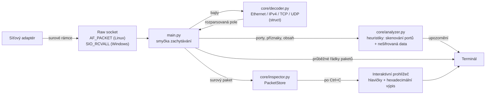

# HexHound

[English](README.md) · **Česky**

HexHound je analyzátor síťového provozu napsaný v čistém Pythonu, který zachytává živý IPv4 provoz přes raw socket a bajt po bajtu dekóduje hlavičky Ethernet, IP, TCP a UDP pomocí modulu `struct`, bez `scapy` či jiných knihoven pro parsování paketů. Za běhu upozorňuje na skenování portů a na přihlašovací údaje přenášené v nešifrovaném textu a po zastavení zachytávání umožňuje prohlédnout hlavičky i obsah libovolného paketu včetně hexadecimálního výpisu.

<!-- Sem vložte skutečný záznam: uložte ho jako docs/demo.gif (nebo .png) a odkomentujte následující řádek.

-->

## Ukázka výstupu

Ilustrativní relace (adresy pocházejí z rezervovaných dokumentačních rozsahů; výstup programu je v angličtině):

```text
[*] Starting HexHound on interface: all
[*] Listening for traffic. Press Ctrl+C to stop...

#1 TCP | 192.0.2.10:51022 -> 198.51.100.7:80 | Flags: SYN
#2 TCP | 198.51.100.7:80 -> 192.0.2.10:51022 | Flags: SYN,ACK
#3 TCP | 192.0.2.10:51022 -> 198.51.100.7:80 | Flags: ACK,PSH

[!] WARNING: Unencrypted HTTP traffic detected (192.0.2.10:51022 <-> 198.51.100.7:80).

[!!!] CRITICAL: Potential sensitive data (Cleartext) found in payload!
      Flow: 192.0.2.10:51022 -> 198.51.100.7:80
      Matched Keyword(s): 'password=', 'user='
#4 UDP | 192.0.2.10:5353 -> 224.0.0.251:5353 | Size: 71

[*] Stopping HexHound Capture...
[*] Total Packets Processed: 212 (0 malformed/truncated)

[*] Packet inspector: 212 packets stored (#1 to #212).

hexhound> 3
======================================================================
 Packet #3   captured 2026-10-23 19:07:53.929   312 bytes on the wire
======================================================================

[IPv4]
  Source IP         : 192.0.2.10
  Destination IP    : 198.51.100.7
  TTL               : 64
  Protocol          : 6 (TCP)
  ...
[TCP]
  Source port       : 51022
  Destination port  : 80
  Flags             : ACK PSH
  ...
[Payload] 258 bytes
  --- as text ---
  POST /login HTTP/1.1
  ...
  --- hex dump ---
  0000  50 4f 53 54 20 2f 6c 6f 67 69 6e 20 48 54 54 50  |POST /login HTTP|
```

## Funkce

- **Ručně psané dekódování protokolů**: hlavičky Ethernet, IPv4, TCP a UDP se rozbalují výhradně standardními moduly `socket` a `struct`. Žádné externí závislosti.
- **Detekce skenování portů**: upozorní, když jeden zdroj pošle samotné pakety SYN na více než 15 různých portů jednoho počítače během 10 sekund.
- **Detekce nešifrovaného provozu**: varuje před provozem FTP, Telnet a HTTP a označí obsah, který obsahuje klíčová slova typická pro přihlašovací údaje (`password=`, `user=`, `login`, ...). Každé upozornění se pro dané spojení zobrazí jen jednou.
- **Prohlížeč paketů**: po stisku `Ctrl+C` vyberete libovolný zachycený paket podle čísla a zobrazí se všechna pole hlaviček i obsah jako text a hexadecimální výpis.
- **Odolné parsování**: zkrácené, poškozené a fragmentované pakety se přeskočí a spočítají, místo aby zachytávání spadlo.
- **Zachytávání na více platformách**: `AF_PACKET` na Linuxu, raw IP sokety s `SIO_RCVALL` ve Windows.

## Architektura



| Soubor | Úloha |
|---|---|
| `main.py` | Otevře raw socket, spouští smyčku zachytávání a propojuje všechny části |
| `core/decoder.py` | Parsery hlaviček na úrovni bajtů (parsery všech polí a rozbalovače vracející n-tice) |
| `core/analyzer.py` | `SecurityAnalyzer`: detekce skenování portů a kontrola nešifrovaného obsahu |
| `core/inspector.py` | Kruhová vyrovnávací paměť `PacketStore`, formátování paketů, hexadecimální výpis a interaktivní příkazový řádek |

## Jak začít

**Požadavky:** Python 3.10+ a oprávnění správce/root (raw sockety je vyžadují). Není potřeba žádné `pip install`.

```bash
git clone <url-vašeho-repozitáře>
cd <složka-repozitáře>
```

**Linux**

```bash
sudo python3 main.py              # všechna rozhraní
sudo python3 main.py -i eth0      # jedno rozhraní
```

**Windows** (otevřete PowerShell přes *Spustit jako správce*)

```powershell
python main.py                    # hlavní adaptér
python main.py -i 192.168.1.25    # konkrétní adaptér podle jeho IP adresy
```

macOS není podporován: pakety zpřístupňuje přes BPF (`/dev/bpf*`), nikoli přes `AF_PACKET`.

| Přepínač | Význam | Výchozí |
|---|---|---|
| `-i`, `--interface` | Název rozhraní (Linux) nebo IP adresa adaptéru (Windows) | všechna / hlavní adaptér |
| `-b`, `--buffer` | Kolik posledních TCP/UDP paketů se uchová pro prohlížení | 10000 |

Stiskem `Ctrl+C` zastavíte zachytávání a otevřete prohlížeč paketů:

| Příkaz | Akce |
|---|---|
| `12` nebo `#12` | Zobrazí všechny podrobnosti paketu 12 |
| `l [text]` | Vypíše posledních 30 paketů, volitelně filtrovaných (`l 10.0.0.5`, `l :443`, `l SYN`) |
| `h` | Nápověda |
| `q` | Konec |

## Jak funguje detekce

- **Skenování portů**: pro každou zdrojovou IP adresu HexHound sleduje, na kolik různých cílových portů každého cílového počítače poslala samotné pakety `SYN` v desetisekundovém okně. Více než 15 spustí upozornění. Počítají se jen samotné SYN, protože kdyby se počítal každý paket, server odpovídající klientovi by vypadal jako skener. Ze stejného důvodu je vyloučeno UDP (bez sledování spojení nelze odpověď od požadavku odlišit).
- **Nešifrovaný obsah**: jakákoli data na portu 21, 23 nebo 80 vyvolají jednorázové varování pro dané spojení. Obsah se také bez ohledu na velikost písmen prohledává na `password=`, `pwd=`, `user=`, `login`, `admin` a `auth`. Jde o heuristiky, které na běžných webových stránkách budou dávat falešné poplachy.

## Omezení

- Pouze IPv4. IPv6, ARP a ICMP se nedekódují.
- Viditelný je jen provoz, který dorazí na váš adaptér. V přepínané síti nebo přes Wi-Fi jde o váš vlastní provoz plus broadcast a multicast (například mDNS), nikoli o komunikaci ostatních zařízení.
- HTTPS a další šifrovaný obsah se zobrazí jako šifrový text, takže kontroly nešifrovaného obsahu fungují jen u nešifrovaných protokolů.
- Zachytávání ve Windows začíná na vrstvě IP, takže chybí hlavičky Ethernet.

## Zodpovědné používání

Zachytávejte provoz jen v sítích, které vlastníte nebo které máte výslovné povolení sledovat. Odposlouchávání cizího provozu může být podle zákona protiprávní.
