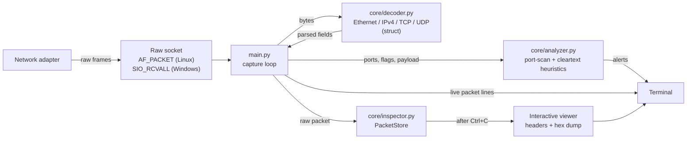

# HexHound

**English** · [Česky](README.cs.md)

HexHound is a network traffic analyzer written in pure Python that captures live IPv4 traffic from a raw socket and decodes Ethernet, IP, TCP and UDP headers byte by byte with `struct`, with no `scapy` or other parsing libraries. It flags port scans and cleartext credentials as they happen, and lets you stop the capture and inspect any packet's headers and payload in a hex dump.

<!-- Add a real capture here: save it as docs/demo.gif (or .png) and uncomment the next line.

-->

## Example output

Illustrative session (addresses are from the reserved documentation ranges):

```text
[*] Starting HexHound on interface: all
[*] Listening for traffic. Press Ctrl+C to stop...

#1 TCP | 192.0.2.10:51022 -> 198.51.100.7:80 | Flags: SYN
#2 TCP | 198.51.100.7:80 -> 192.0.2.10:51022 | Flags: SYN,ACK
#3 TCP | 192.0.2.10:51022 -> 198.51.100.7:80 | Flags: ACK,PSH

[!] WARNING: Unencrypted HTTP traffic detected (192.0.2.10:51022 <-> 198.51.100.7:80).

[!!!] CRITICAL: Potential sensitive data (Cleartext) found in payload!
      Flow: 192.0.2.10:51022 -> 198.51.100.7:80
      Matched Keyword(s): 'password=', 'user='
#4 UDP | 192.0.2.10:5353 -> 224.0.0.251:5353 | Size: 71

[*] Stopping HexHound Capture...
[*] Total Packets Processed: 212 (0 malformed/truncated)

[*] Packet inspector: 212 packets stored (#1 to #212).

hexhound> 3
======================================================================
 Packet #3   captured 2026-10-23 19:07:53.929   312 bytes on the wire
======================================================================

[IPv4]
  Source IP         : 192.0.2.10
  Destination IP    : 198.51.100.7
  TTL               : 64
  Protocol          : 6 (TCP)
  ...
[TCP]
  Source port       : 51022
  Destination port  : 80
  Flags             : ACK PSH
  ...
[Payload] 258 bytes
  --- as text ---
  POST /login HTTP/1.1
  ...
  --- hex dump ---
  0000  50 4f 53 54 20 2f 6c 6f 67 69 6e 20 48 54 54 50  |POST /login HTTP|
```

## Features

- **Hand-written protocol decoding**: Ethernet, IPv4, TCP and UDP headers unpacked with the standard `socket` and `struct` modules only. Zero third-party dependencies.
- **Port-scan detection**: alerts when one source sends bare SYN packets to more than 15 distinct ports on one host within 10 seconds.
- **Cleartext detection**: warns about FTP, Telnet and HTTP traffic and flags payloads containing credential-like keywords (`password=`, `user=`, `login`, ...). Each alert fires once per connection.
- **Packet inspector**: after `Ctrl+C`, pick any captured packet by number to see every header field plus the payload as text and a hex dump.
- **Robust parsing**: truncated, malformed and fragmented packets are skipped and counted instead of crashing the capture.
- **Cross-platform capture**: `AF_PACKET` on Linux, `SIO_RCVALL` raw IP sockets on Windows.

## Architecture



| File | Responsibility |
|---|---|
| `main.py` | Opens the raw socket, runs the capture loop, wires everything together |
| `core/decoder.py` | Byte-level header parsers (full-field parsers and tuple-style unpackers) |
| `core/analyzer.py` | `SecurityAnalyzer`: port-scan detection and cleartext inspection |
| `core/inspector.py` | `PacketStore` ring buffer, packet formatter, hex dump and interactive prompt |

## Getting started

**Requirements:** Python 3.10+ and administrator/root rights (raw sockets need them). No `pip install` step.

```bash
git clone <your-repo-url>
cd <repo-folder>
```

**Linux**

```bash
sudo python3 main.py              # all interfaces
sudo python3 main.py -i eth0      # one interface
```

**Windows** (open PowerShell with *Run as administrator*)

```powershell
python main.py                    # main adapter
python main.py -i 192.168.1.25    # a specific adapter, by its IP address
```

macOS is not supported: it exposes packets through BPF (`/dev/bpf*`), not `AF_PACKET`.

| Option | Meaning | Default |
|---|---|---|
| `-i`, `--interface` | Interface name (Linux) or adapter IP address (Windows) | all / main adapter |
| `-b`, `--buffer` | How many recent TCP/UDP packets to keep for inspection | 10000 |

Press `Ctrl+C` to stop the capture and open the inspector:

| Command | Action |
|---|---|
| `12` or `#12` | Show every detail of packet 12 |
| `l [text]` | List the last 30 packets, optionally filtered (`l 10.0.0.5`, `l :443`, `l SYN`) |
| `h` | Help |
| `q` | Quit |

## How the detection works

- **Port scans**: for each source IP, HexHound tracks the distinct destination ports it sent bare `SYN` packets to, per target host, in a 10-second window. More than 15 triggers an alert. Only bare SYNs are counted, because counting every packet would make a server replying to a client look like a scanner. UDP is excluded for the same reason (a reply is indistinguishable from a request without connection tracking).
- **Cleartext**: any payload on port 21, 23 or 80 triggers a one-time warning for that connection. Payloads are also searched, case-insensitively, for `password=`, `pwd=`, `user=`, `login`, `admin` and `auth`. These are heuristics and will produce false positives on ordinary web pages.

## Limitations

- IPv4 only. IPv6, ARP and ICMP are not decoded.
- Only traffic that reaches your adapter is visible. On a switched or Wi-Fi network that means your own traffic plus broadcast and multicast (such as mDNS), not other devices' conversations.
- HTTPS and other encrypted payloads appear as ciphertext, so the cleartext checks only work on unencrypted protocols.
- The Windows capture starts at the IP layer, so there are no Ethernet headers.

## Responsible use

Only capture traffic on networks you own or have explicit permission to monitor. Intercepting other people's traffic may be illegal where you live.
